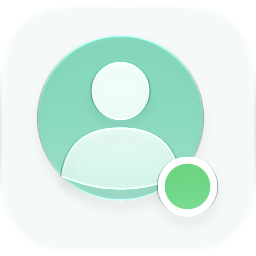
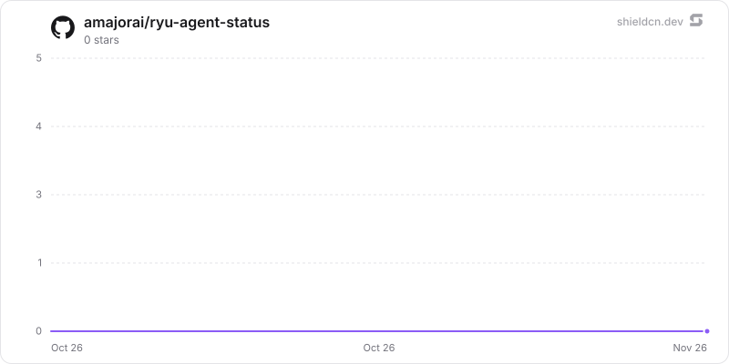

<p align="center">
  <picture>
    <source media="(prefers-color-scheme: dark)" srcset="./icon-dark.png" />
    
  </picture>
</p>

<div align="center">

# Agent Status

</div>

Splits your agent runs across three sidebar sections — Working, Needs input and Done — each row showing the project it belongs to.

> **The public home of `ryu-agent-status`.** Source, builds, and releases live here —
> binaries for every platform are attached to each release.
>
> This tree is generated from the Ryu monorepo, so commits pushed here
> directly are replaced on the next sync. **Pull requests are welcome** —
> open them here and they are ported into the monorepo, then flow back out.
> Ryu as a whole: https://github.com/amajorai/ryu

## Install

**App:** [Install](ryu://apps/@ryu/agent-status) (opens the Ryu desktop app and asks you to confirm)

**CLI:**

```bash
ryu apps add @ryu/agent-status
```

## Source & build

This is the **source of record** for the app UI. It imports Ryu's private
`@ryu/ui` design system, so it does **not** build standalone outside the
monorepo — it **builds inside the amajorai/ryu monorepo workspace**.
The shipped bundle is the built artifact, produced by the monorepo build.

## License

Apache-2.0 — see [LICENSE](./LICENSE).

## Where they land

At the BOTTOM of the sidebar, below the built-in sections. `order` sequences the
three among themselves (Working → Needs input → Done); it does not lift them above
the shell's own sections, which are a separate persisted order the user reorders by
dragging. Drag them wherever you want them — the position sticks.

## How it works

The app is **pure manifest** — no sidecar, no bundle, no code. It declares three
`contributes.sidebar_sections`, each a declarative `spec.source` the desktop shell
fetches through its own authenticated Core seam:

- `source.filter` slices one endpoint into several sections. `/api/runs` takes no
  query parameters, so Working and Done are both `run_status` slices of the same
  response — and, sharing a source, the same single cached request.
- `source.map.subtitleTransform: "basename"` turns `/Users/me/code/ryu` into `ryu`.
- `source.refreshMs` keeps the lists live while the section is expanded.
- `spec.emptyState` keeps the header when a section is empty: "nothing is running"
  is an answer, and an app you opted into should not silently drop a third of what
  it promised.

## Approvals is a soft dependency, deliberately

Needs input reads `/api/approvals`, which Core mounts only while the **Approvals**
app is enabled, and its rows open that app's Inbox.

That is NOT declared as a `requires.apps` edge. Approvals is opt-in and
install-on-demand, and Core resolves `requires` against the INSTALLED set: a hard edge
would make enabling this app fail outright with `missing_dependency` on a fresh
machine — losing all three sections to get one. Instead the section degrades, and
`emptyState.unavailable` says exactly which app to turn on. (The two states are
distinguished for real: the shell only prints "nothing waiting" when Core actually
answered.)

One side effect worth knowing: because Needs input's `itemTarget` is the static
`/inbox`, this app's glyph becomes the Inbox tab's icon while it is enabled.

## Known limitation

A run blocked on a permission prompt is still `run_status: "running"`, so it appears
under **both** Working and Needs input. The two sections come from different
endpoints and the declarative vocabulary has no cross-source exclusion; expressing
one would mean a Core-side "awaiting input" run status, which is a bigger change
than this app.

## Star History

<a href="https://github.com/amajorai/ryu-agent-status/stargazers">
  <picture>
    <source media="(prefers-color-scheme: dark)" srcset="./.github/shieldcn/star-chart-dark.svg" />
    
  </picture>
</a>
